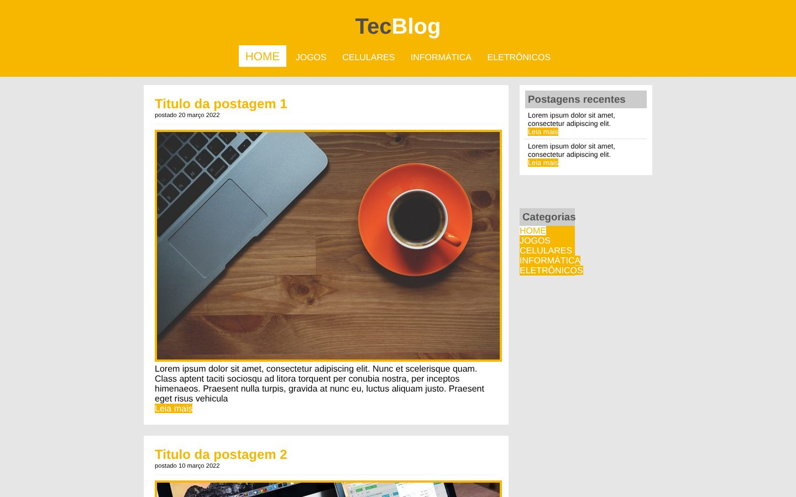
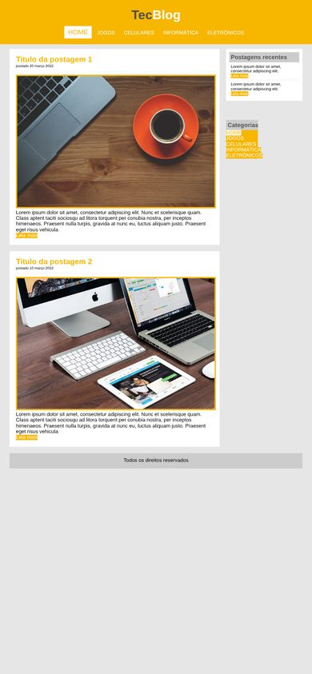

# TecBlog

Layout de um blog de tecnologia com várias páginas, feito com HTML e CSS como projeto de estudo.
Multi-page tech blog layout built with HTML and CSS as a learning project.

[🇧🇷 Português](#-português) · [🇺🇸 English](#-english)

<p align="center">
  
  
</p>

---

## 🇧🇷 Português

### Sobre o projeto

Modelo de blog de tecnologia com uma página inicial de postagens e páginas por categoria: **Jogos**, **Celulares**, **Informática** e **Eletrônicos**. Os textos são de preenchimento (lorem ipsum). O foco do projeto é a estrutura das páginas, o menu de navegação e o layout dos cards de postagem.

### Tecnologias

- HTML5
- CSS3

### Como usar

Baixe o repositório e abra o `index.html` no navegador.

### Estrutura

```
index.html                         página inicial com as postagens
jogos.html, celulares.html,
informatica.html, eletronicos.html páginas de categoria
css/estilo.css                     estilos
imagens/                           imagens das postagens
```

---

## 🇺🇸 English

### About

A tech blog template with a home page of posts and one page per category: **Games**, **Phones**, **Computers** and **Electronics**. The text is placeholder (lorem ipsum). The project focuses on page structure, the navigation menu and the post card layout.

### Tech stack

- HTML5
- CSS3

### Usage

Download the repository and open `index.html` in your browser.
